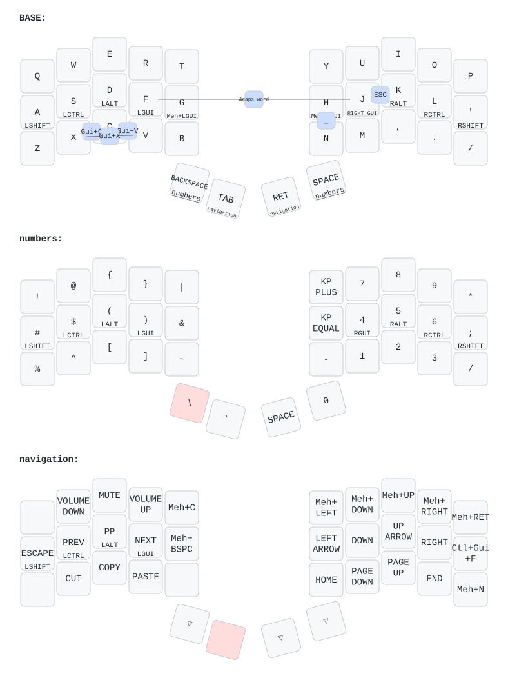

# My ZMK forager config

based on:
- https://github.com/Keycapsss/zmk-config/tree/main

## Keymap

QWERTY base with GACS home row mods, vim-style navigation, and a
urob-inspired setup (timeless positional home row mods, punctuation
mod-morphs, smart num layer).

The diagram above is generated automatically from
[`config/forager.keymap`](config/forager.keymap) by
[keymap-drawer](https://github.com/caksoylar/keymap-drawer) via the
[Draw keymap](.github/workflows/draw-keymap.yml) workflow whenever the
keymap changes.

### Hyper and window keys

- **Hyper (⌃⌥⇧⌘) for apps:** hold `G` and tap a right-hand key, or hold `H`
  and tap a left-hand key. They use the same cross-hand home-row-mod behavior,
  so typing stays letters. Assign `Hyper+letter` to apps in Raycast
  (Settings → Extensions → Applications → record hotkey). Leave `Hyper+.`
  unassigned: macOS uses it for sysdiagnose.
- **Window snapping:** hold the `Tab` thumb (navigation layer) and tap:

  | Key | Sends | Raycast Window Management command |
  | --- | ----- | --------------------------------- |
  | `Y` | ⌃⌥⇧←  | Left Half                         |
  | `O` | ⌃⌥⇧→  | Right Half                        |
  | `I` | ⌃⌥⇧↑  | Top Half                          |
  | `U` | ⌃⌥⇧↓  | Bottom Half                       |
  | `P` | ⌃⌥⇧↩  | Maximize                          |
  | `T` | ⌃⌥⇧C  | Center                            |
  | `G` | ⌃⌥⇧⌫  | Restore                           |
  | `/` | ⌃⌥⇧N  | Next Display                      |
  | `'` | ⌃⌘F   | macOS full screen (no setup)      |

  Record each hotkey in Raycast (Settings → Extensions → Window Management) by
  pressing the key combination on the keyboard.
